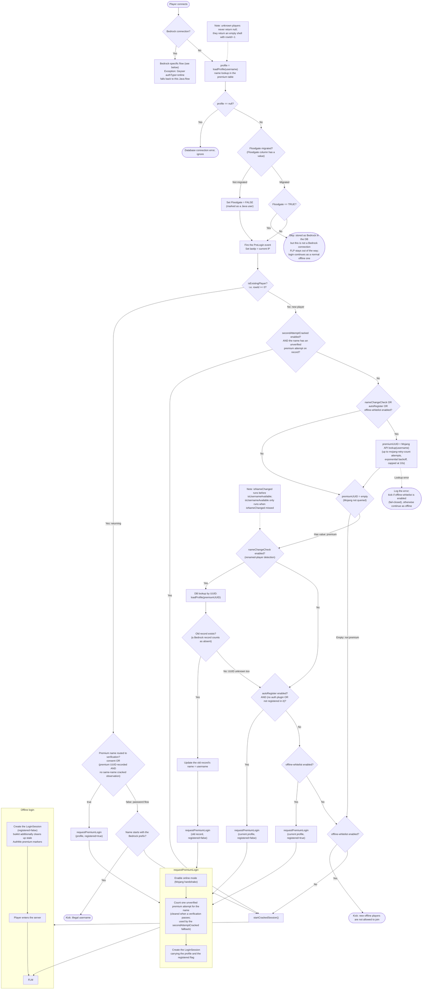
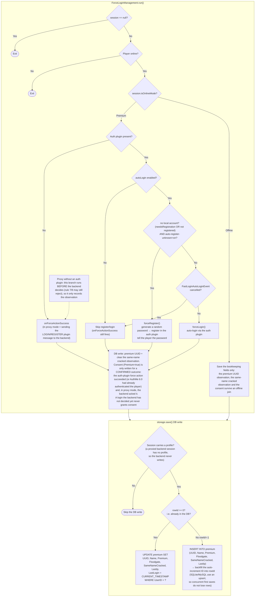
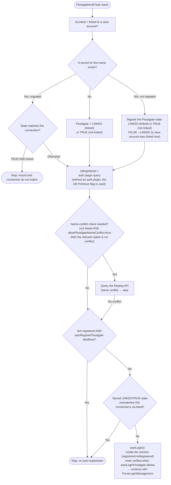
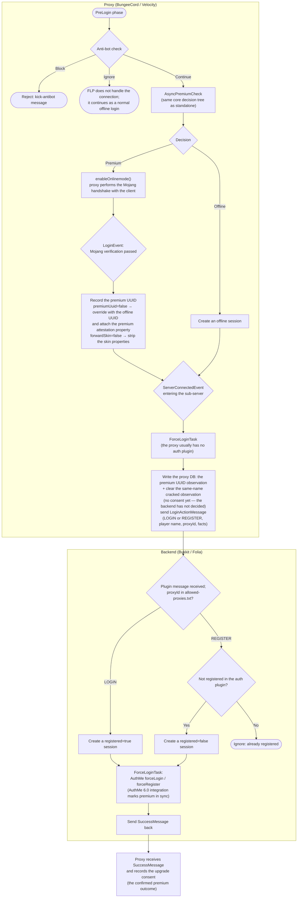

# FastLoginPlus Login Flow

[中文→](../zh/LOGIN-FLOW.md)

## Overview

When a player connects, FastLoginPlus makes its decisions in this order:

1. **Anti-bot check** (packet entry point in standalone mode, PreLogin phase on a proxy; not performed on a proxied backend)
2. **Database lookup by name** → distinguishes returning players (record exists) from new players (no record)
3. **Returning player** → handled directly according to the last login mode (premium/offline)
4. **New player** → Mojang API query decides whether the account is premium, then config decides how to handle it
5. **After the Mojang handshake** → the ForceLogin manager performs auth-plugin registration/login and writes the database

This document has four parts:

- **Main flow** (standalone backend mode, bukkit/folia, ProtocolLib path) — the core decision tree shared by all platforms, defined by the `JoinManagement` template method in core
- **Bedrock (Geyser/Floodgate) flow** — Bedrock players skip the main decision tree
- **Proxy mode** (BungeeCord / Velocity + backend) — decisions and DB writes happen on the proxy; the backend only executes auth actions
- **Commands and Anti-bot** — manual player-state changes and connection admission

## Main Flow

Notes:

- `loadProfile(name)` returns `null` only on a SQL error; unknown players get an empty shell with `rowId = -1` (`isExistingPlayer() == false`), so branch `E` is almost never taken.
- The whole load-to-session window (returning-player branch) runs inside a **name-level striped lock**, so concurrent logins, admin commands and plugin-message saves for the same name cannot interleave (since 0.5.0).
- The **same-name cracked observation** replaces the old single-use marker: premium verification attempts are tracked **per name** and **one settled, definitive failure** confirms the observation (a session-server outage never counts — see the behavior notes below). Once confirmed, the name is recorded (`SameNameCracked`) and every later connection goes straight to the password flow instead of failing one connection first. The confirmation that first flips the flag shows a **one-time chat notice** (`same-name-cracked-recorded`) telling the player the name was recorded as cracked and how to re-verify with `/flp premium` — delivered when the player reaches the game (by the proxy in proxy mode, so classic and Fabric backends alike), and later joins of an already recorded name are silent. The fallback only applies to names **without consent**: a consented name is verified on every connection, so nobody can drag a premium name into the password flow by connecting with a cracked client. The observation is **read together with the config**: with `secondAttemptCracked` off a recorded name is treated as never marked and verifies again (and a passing verification then clears the stale mark).
- The same fallback also covers returning names whose premium identity is recorded but not consented: after the observed failures they reach the password flow, where the account owner can log in with their password and run `/flp premium` (rule 7's recovery path).
- `requestPremiumLogin` and `startCrackedSession` are platform implementations: bukkit/folia cancel the original START packet via ProtocolLib and inject the online-mode handshake (the ProtocolSupport path is similar); on a proxy `enableOnlinemode()` makes the proxy perform the handshake with the client.

## ForceLoginManagement.run() (session execution phase)

After a session is created, the unified login management runs at the right time:

- **bukkit/folia standalone**: ~10 ticks after `PlayerJoinEvent` (so auth plugins can initialize the player) → `ForceLoginTask`
- **Proxy side**: `ServerConnectedEvent` (entering the sub-server) → `ForceLoginTask`
- **Proxied backend**: immediately after receiving the proxy's `LoginActionMessage` (or once the join event has fired) → `ForceLoginTask`

## The Four requestPremiumLogin Call Sites

`requestPremiumLogin` is called from four different scenarios with different arguments:

| Trigger | profile argument | registered | Effect |
|---|---|---|---|
| Returning premium name (consent, or a premium UUID observation) | The original DB record | true | Online-mode verification again, then auto-login |
| `nameChangeCheck` | The **old record** found by UUID (preserves history) | false | Update the name + register with the auth plugin |
| `autoRegister` | The **current profile** looked up by name (possibly an empty shell) | false | Register with the auth plugin |
| `offline-whitelist` | The **current profile** looked up by name (possibly an empty shell) | true | Admission only, no registration |

The `registered` flag drives `ForceLoginManagement`:
- `registered=false` → `needsRegistration()=true` → `forceRegister()` (auto-registration)
- `registered=true` → `needsRegistration()=false` → `forceLogin()` (auto-login)
- The whole "no local account" side (`needsRegistration` or not registered) is gated by `auto-register-unknown` (F-15 A): on (default) the account is auto-created for the verified identity, off the player gets the auth plugin's own register dialog and sets a password — never an automatic account

## Bedrock (Floodgate / Geyser) Flow

Bedrock players **do not go through the Java decision tree above**. Handling has two phases:

1. **Connection decision phase** (at the top of `JoinManagement.onLogin`):
   - `FloodgateService.performChecks()`: name-conflict check according to `allowFloodgateNameConflict`, then **always takes over** the connection (returns true → the main flow ends)
   - `GeyserService.performChecks()` (plain Geyser without Floodgate): only falls back to the Java flow when Geyser's `authType=online` (Bedrock players already authenticated with Mojang are treated like premium Java players); otherwise it takes over too
   - If the player disconnects between the two phases, they are treated as having no Bedrock context and the checks are skipped
2. **Login execution phase** (after the player joins, the platform schedules `FloodgateAuthTask`, i.e. `FloodgateManagement.run()`):

- Values for `autoLoginFloodgate` / `autoRegisterFloodgate`: `true` / `false` / `linked` (only linked Bedrock players) / `no-conflict` (only when the name does not clash with a premium Java account)
- Bedrock rows are written with an empty UUID (following the Floodgate row convention); the username is locked by the record

## Proxy Mode (BungeeCord / Velocity)

This section describes Bukkit/Folia backends. The opt-in Velocity + Fabric 26.2 path uses the same proxy decision tree: the proxy forwards the identity facts and the Fabric mod decides the login method from its own EasyAuth account state. An existing password account can queue an upgrade with `/flp premium`, which pins the premium UUID of its name and never touches the account; the account is converted to passwordless only at the first successful passwordless login whose verified UUID matches that pin. The queued upgrade lives for ten minutes; when it expires (or the backend restarted in between) the password account keeps working and `/flp premium` can simply be run again — nothing is locked out. Claims from a proxy are only accepted when the proxy's ID is listed in the Fabric config's `allowed-proxy-ids` trust key: with an empty list every claim is dropped and the login falls back to the password flow (fail-closed), and FastLoginPlus warns about the empty list at startup and when a `/flp premium` upgrade is dropped because of it.

When `bungee: true` (spigot.yml) or Velocity forwarding is detected, FLP runs in a **proxy/backend split** architecture:

- **Proxy** = decision maker: anti-bot, Mojang queries, premium table reads/writes, the online-mode handshake with the client
- **Backend** = executor: only runs auth-plugin forceLogin / forceRegister and **never writes the DB** (its sessions carry no profile); the proxy DB is the single source of truth, and the backend's ProtocolLib listeners are not registered either

Key points:

- `LoginActionMessage` travels on the plugin message channel `fastloginplus:force`; the `proxyId` is a UUID generated on the proxy's first start (Velocity stores it in `proxyId.txt`, BungeeCord uses the `stats` value of its own `config.yml`, which BungeeCord generates on first start); the backend validates it against `allowed-proxies.txt` to prevent forgery
- The message now also carries the Mojang UUID verified at the proxy's `LoginEvent` (`LoginActionMessage.verifiedPremiumUuid`), so the backend can stamp AuthMe's `premium_uuid` even when `premiumUuid: false` made the connection UUID the offline one
- The message tail also carries the identity facts (new player? same-name cracked? upgrade consent) and the policy values (`autoLogin`, `auto-register-unknown`, `offline-whitelist`). The backend decides the login method from the account state plus those facts and **enforces the declared policy** — its own local copies of those keys are ignored behind a proxy (they only apply in standalone deployments); the local value is consulted only when a proxy declared nothing (an older proxy during a rolling upgrade)
- A REGISTER message is only executed after the backend confirms the player is unregistered; a LOGIN message runs the login directly
- The backend rejects unknown proxyIds and players marked as blocked (anti BungeeCord-ID brute force)
- In proxy mode, `/flp premium|cracked|delete` requests are forwarded from the backend to the proxy (see next section)
- The backend does not have to wait for the message to learn that the connection was verified: since 0.7.0 the proxy attests it on the forwarded profile, which a Paper backend reads in the configuration phase (see *Premium attestation* below)

### Premium attestation

The plugin-message relay above is the *fallback*. The proxy also attaches the verified Mojang UUID to the profile it forwards, so the backend can create the AuthMe record **before** AuthMe's `HIGHEST`-priority handler runs and shows the blocking preJoin dialog:

| Case | Transport | How the backend recognizes it |
|---|---|---|
| `premiumUuid: false` (either proxy) | a profile property: `flp-premium-uuid` on Velocity's modern forwarding, `flp_premium_uuid` on BungeeCord's legacy handshake | the property carries the verified Mojang UUID. BungeeCord cannot use the hyphenated spelling: Paper rebuilds the legacy profile and drops every property name that does not match `\w{0,16}` |
| `premiumUuid: true` (either proxy) | the forwarded connection UUID | no property is attached; the UUID itself is the attestation (a v4 UUID can only have come from the proxy — an offline UUID is always v3) |

Consumers on the backend:

- **Paper (Folia included)**: the `AsyncPlayerConnectionConfigureEvent` handler (`readForwardedPremiumUuid` → `resolveAttestedUuid` → `applyPremiumAtConfigure`) marks the record synchronously and closes both preJoin dialogs; when no attestation is present it falls back to the asynchronous Mojang lookup
- **Spigot and older Paper**: no configuration phase exists, so `PreLoginPremiumListener` calls `applyPremiumAtPreLogin` at `AsyncPlayerPreLoginEvent` — enough to pre-create the record before the join

Guard rails: an attestation only counts when the very same login already carried it on the pre-login profile (a profile-cache replay is logged and ignored), and an administrator's `/flp cracked` wins over a marking that is still in flight.

## Commands (/flp premium|cracked|delete)

On bukkit/folia: `/flp premium [player]`, `/flp cracked [player]`, `/flp delete [player]` (permission prefix `fastloginplus.bukkit.command.*` / `fastloginplus.folia.command.*`; acting on other players requires the `.other` suffix):

- **Standalone mode**: modifies the DB directly (premium ⇄ cracked / delete the record) and kicks the player so the change takes effect on reconnect; `/flp premium` is protected by the `premium-warning` confirmation
- **Proxy mode**: the backend performs the auth-plugin cleanup first (AuthMe lives on the backend), then forwards the toggle request to the proxy via a plugin message (which updates the proxy DB and kicks the player); the backend itself never touches the DB
  - If the target is offline and no online player can carry the message, the request goes into the persistent `pending-relay.json` queue and is re-sent when that player (or anyone) joins; the proxy replies with `ToggleFeedbackMessage` and the backend logs the result to the console
  - The same queue holds a third kind of entry: AuthMe's own `premium.set` / `premium.unset` notices (`premiumNotices`) are queued when no carrier is online and relayed later, because they update AuthMe's *proxy-side* premium cache — the thing that decides `forceOnlineMode()` — and not FLP's own profile
- The command is always registered as `/flp` (plugin.yml) and is never aliased to `/premium`. AuthMe 6.0's own `/premium` and `/freemium` stay registered and are intercepted by `AuthMeCommandGuard` while FLP owns premium handling (the player is told to use `/flp`): they would otherwise change AuthMe's premium state behind FLP's back. The same AuthMe 6.0 detection that gates the takeover also gates that guard, so on AuthMe 5.x both commands still work normally
- A bare `/flp` prints the version and usage and is restricted to server operators; `prem`, `del` and `unpremium` are accepted as subcommand aliases

## Anti-bot

`AntiBotService.onIncomingConnection` runs these checks at the connection entry point, in priority order:

1. **Trusted IP** (`anti-bot.trusted-ips`) → allow
2. **Currently banned** (auto-ban after exceeding the per-IP limit, lasting `ban-duration`) → reject
3. **Global connection rate** (`connections` within the `expire` minute window) → reject
4. **Per-IP rate** (long window + burst window) → over-limit auto-bans the IP and rejects

The rejection action comes from `anti-bot.action`: `ignore` (FLP silently stops handling the connection; login continues as a normal offline login) / `block` (reject with the `kick-antibot` message). Third-party plugins can listen to `FastLoginAntiBotEvent` to override the decision.

Where it is mounted: standalone mode at the ProtocolLib / ProtocolSupport packet-listener entry; on the proxy at the PreLogin phase; **not at all on a proxied backend** (the proxy is responsible).

## Key Config Options

Defaults shown below are the current values from `core/src/main/resources/config.yml`:

| Option | Responsibility | Default |
|---|---|---|
| `nameChangeCheck` | Query the Mojang API, detect renamed players by UUID and update their old DB record | true |
| `autoRegister` | Auto-register new premium players with the auth plugin (forceRegister) | true |
| `autoLogin` | Auto-login premium players with the auth plugin (forceLogin) | true |
| `auto-register-unknown` | Auto-create a local account for a **verified premium** player the auth plugin has no account for (deleted/drifted databases). Off = the register dialog instead. Never for offline/cracked names — they carry no identity proof and set their own password (the key name misleads: "unknown" is the missing local account, not strangers) | true |
| `offline-whitelist` | Access control: admit premium players, kick new offline players, let returning offline players join | false |
| `premiumUuid` | Whether to use the premium UUID after premium verification (does not decide whether premium verification is enabled) | true |
| `forwardSkin` | Forward the premium skin to the player (SkinsRestorer custom skins take priority) | true |
| `secondAttemptCracked` | A name whose premium verification attempt does not verify is remembered per name and joins offline next time (persistent same-name cracked observation). Read together with the config: off = recorded names verify again | false |
| `mojang-retry-count` / `mojang-retry-delay` | Mojang API retry count on network failures / base backoff delay (exponential, capped at 10s) | 3 / 500 |
| `anti-bot.enabled` / `anti-bot.action` | Anti-bot switch / action when limits are hit (ignore/block) | true / ignore |
| `autoLoginFloodgate` / `autoRegisterFloodgate` / `allowFloodgateNameConflict` | Bedrock auto-login / auto-registration / name-conflict policy (true/false/linked/no-conflict) | false / false / false |
| `verifyClientKeys` / `respectIpLimit` | Standalone mode only (client public-key verification / auth-plugin per-IP registration limit) | false / false |

Note: `premiumUuid` points in the opposite direction on a standalone backend versus a proxy — a standalone backend is an offline-mode server, so `true` means **injecting** the premium UUID; a proxy naturally gets the premium UUID from online-mode verification, so `false` is what overrides it with the offline UUID.

## Record Semantics (observations + consent)

Each row of the `premium` table is a per-name record with three kinds of state, kept deliberately separate:

| Column | Meaning | Written by | Cleared by |
|---|---|---|---|
| `UUID` | **Observation**: the Mojang UUID this name verified with (a fact about the *name*) | a passing verification, `/flp premium` | `/flp cracked`, `/flp delete` |
| `Premium` | **Upgrade consent**: this name's premium login is allowed to open the account without a password | `/flp premium`, and a *confirmed* premium outcome (the backend auto-registered or auto-logged the verified identity, incl. the auth-plugin premium-account sync) | `/flp cracked` |
| `SameNameCracked` | **Observation**: premium verification for this name failed with a definitive verdict and none passed since (a cracked client under a premium name) | one settled definitive failure (see `secondAttemptCracked`; outages and interruptions never count) | a passing verification, `/flp premium`, `/flp cracked`; also cleared in bulk at startup/reload when `secondAttemptCracked` is off |

Two rules follow from the split:

1. **A login that has not been decided yet never records consent.** The proxy writes the observation when the connection is verified, but the consent only lands when the backend confirmed a premium outcome (its `SuccessMessage` ack) or the player/admin said so with `/flp premium`. A rejected login (rule 7/8 ownership conflict) leaves the record exactly as "observed, not consented", so a later reconnect reproduces the same decision instead of turning into a passwordless takeover.
2. **Routing follows the record's facts.** A name goes through premium verification when it is consented, or when its premium UUID observation is intact and no same-name cracked observation was recorded. Consented names always verify (nobody can push them into the password flow with a cracked client); observed-cracked names skip the doomed attempt and go straight to the password flow.

**Recovery when the consent was never recorded** (for example a confirmed auto-registration whose ack was lost because the player disconnected in between): the name then sits at "observed, not consented" and rule 7 rejects every premium login of it. The rejection is a kick, and a premium client keeps passing the verification — which resets the unverified-attempt counter, so the same-name cracked fallback never triggers for it — so **a premium client cannot reach any password dialog here and cannot fix this itself**. Two ways out:

1. **An administrator runs `/flp premium <name>`** — the consent is recorded at once and the next premium login goes through.
2. With `secondAttemptCracked` enabled, the account owner connects with a **cracked** client: the failed attempt confirms the same-name cracked observation (which also shows the one-time "recorded as cracked" notice pointing at `/flp premium`), the name drops to the password flow, and after logging in with the account password they run `/flp premium` themselves. (The generated password of an auto-registered account was only printed once at registration; without it this path still ends at the administrator.) With `secondAttemptCracked: false` only the first way is left.

Older databases keep working: the observation column is added in place at startup and old rows read as "not observed"; an old `Premium=true` row reads as consent (that is what the flag meant when the row was written).

Startup (and any config reload) also **reconciles** the marks with the config: with `secondAttemptCracked` off, every `SameNameCracked` flag is cleared in the database (only that column). The config can change while the server is down, so there is no runtime change event to catch — reconciling at load time is what keeps stale marks from resurfacing when an administrator toggles the switch back and forth. The read-side check above stays the authority; this cleanup just keeps the database consistent with it.

## Behavior Changes (identity/record rework)

User-visible changes compared with earlier releases:

- **A rejected takeover attempt no longer flips the record.** Previously a verified connection recorded `Premium=true` before the backend had decided, so one rejected login could turn a foreign password account into a passwordless login on the next try. Consent now only follows confirmed outcomes or the explicit toggle.
- **`secondAttemptCracked` is persistent and per name.** The old single-use marker (IP + name, five minutes, consumed by the next connection) is gone: attempts are tracked per name and **only a settled, definitive failure counts**. The first confirmation shows a one-time chat notice (`same-name-cracked-recorded`) telling the player the name was recorded as cracked and how to re-verify with `/flp premium`. What counts as definitive is per chain: on a standalone server the session check itself tells the cases apart — Mojang explicitly rejected the session (counted), the session server could not be reached (not counted, FLP kicks with `auth-server-unreachable`: "The authentication servers are unreachable right now, so your premium identity could not be confirmed. Please reconnect later."), the player left mid-verification (not counted). Behind a proxy the proxy owns the session check and exposes no verdict, so the attempt is judged about 12 seconds after it was requested by probing the session server: unreachable = an authentication outage → not counted (the proxy's own message explains it; Bungee's wording is vague but that is proxy behavior), reachable = the client itself → counted. **Known boundary**: a player whose own network dropped while Mojang was up cannot be told apart and is counted once — the one-time notice and `/flp premium` cover that case.
- **An unfinished name lookup never degrades a player.** When the Mojang name lookup cannot complete (rate limit, network trouble, an interrupted retry), FastLoginPlus kicks with `auth-server-unreachable` ("The authentication servers are unreachable right now, so your premium identity could not be confirmed. Please reconnect later.") instead of treating the name as cracked. This closes a serious hazard: a brand-new premium player hitting a lookup failure used to be sent to the register dialog, would create a password account and — with neither consent nor a premium-UUID observation on record — would never verify again, losing the passwordless login for good. Only "the lookup succeeded and Mojang has no such name" is a definite "not premium" and goes to the register flow. **Cost**: while Mojang is flaking or rate-limiting, NEW names cannot join (recorded players are unaffected — they never hit this lookup).
- **Behind a proxy the backend ignores its local policy keys.** `autoRegister`, `autoLogin`, `auto-register-unknown` and `offline-whitelist` are decided by the proxy and enforced from the identity facts; the backend's own copies only apply in standalone deployments (as the config templates always said). `auto-register-unknown` now also gates the "verified premium player without a local account" cell (auto-create vs. the register dialog) — see the key's config comment for its exact scope.
- **Login-time rejections moved to the backend decision.** The old pre-login account query (and the one-shot binding cookie on Fabric) is gone: ownership conflicts are now rejected by the backend's decision from the account state plus the identity facts, which means the rejection happens at the login the facts describe instead of a speculative earlier probe.
