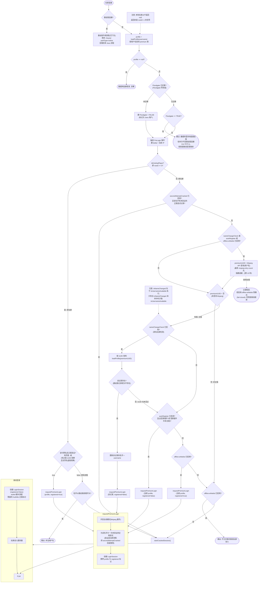
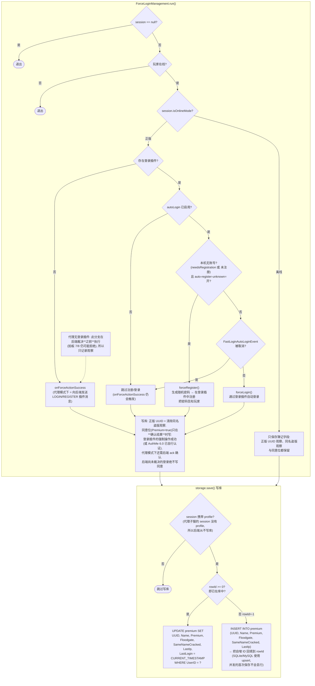
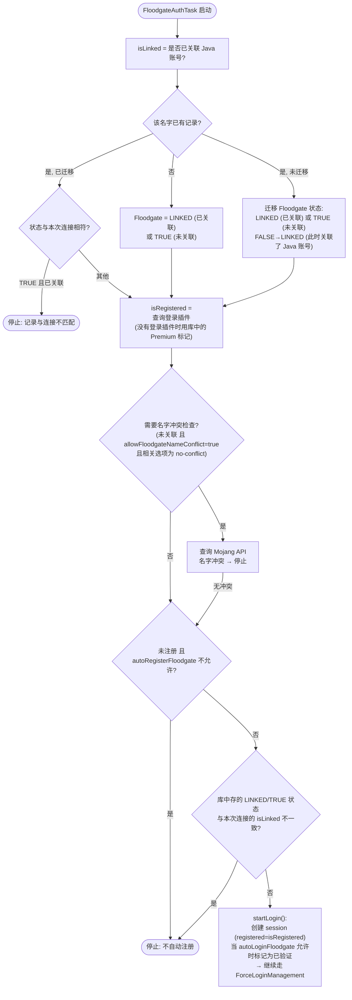
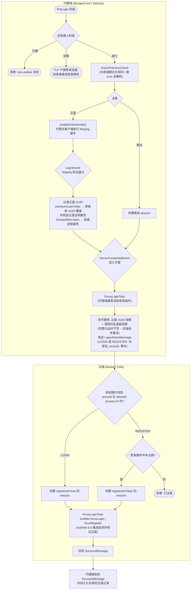

# FastLoginPlus 登录流程

[English→](../en/LOGIN-FLOW.md)

## 总览

玩家连接时, FastLoginPlus 按以下顺序做出判断:

1. **反机器人检查**(单端模式下在数据包入口点, 代理端在 PreLogin 阶段; 代理子服上不执行)
2. **按名字查数据库** → 区分老玩家(有记录)与新玩家(无记录)
3. **老玩家** → 直接按上次的登录模式(正版/离线)处理
4. **新玩家** → 由 Mojang API 查询决定账号是否正版, 再由配置决定如何处理
5. **Mojang 握手完成后** → ForceLogin 管理器执行登录插件的注册/登录并写入数据库

本文档分四部分:

- **主流程**(单端后端模式, bukkit/folia, ProtocolLib 路径)—— 所有平台共用的核心决策树, 由 core 中 `JoinManagement` 的模板方法定义
- **基岩版(Geyser/Floodgate)流程** —— 基岩版玩家跳过主决策树
- **代理模式**(BungeeCord / Velocity + 后端)—— 决策与数据库写入都发生在代理端; 后端只执行登录动作
- **命令与反机器人** —— 手动修改玩家状态与连接准入

## 主流程

说明:

- `loadProfile(name)` 只在 SQL 出错时返回 `null`; 未知玩家拿到的是 `rowId = -1` 的空壳(`isExistingPlayer() == false`), 所以分支 `E` 几乎不会走到.
- 从读库到建 session 的整个窗口(老玩家分支)都在**按名字的条带锁**内执行, 因此同一名字的并发登录、管理命令与插件消息保存不会交错(自 0.5.0 起).
- **同名盗版观察**取代了旧的一次性标记: 正版验证尝试**按名字**跟踪, **一次"已结算的确定失败"**即确认观察(会话服不可达之类的抽风永不计入, 见下文行为变化). 观察一经确认就落库(`SameNameCracked`), 该名字之后的连接直达密码流程, 不再先失败一次; 首次翻转标记的那次确认会给玩家**一次性聊天提示**(`same-name-cracked-recorded`), 告知名字已被记录为盗版以及如何用 `/flp premium` 重新验证 -- 提示在玩家进服后由代理投递(代理模式下经典与 Fabric 后端同样收到), 已记录名字的后续登录不再提示. 该回退只作用于**无同意**的名字: 有同意的名字每次连接都验证, 任何人都无法用盗版客户端把正版名字拖进密码流程. 观察的**读取跟随配置**: `secondAttemptCracked` 关闭时被记过的名字当作未记过、照常验证(验证成功后顺手清掉旧标记).
- 同一回退也覆盖"有正版 UUID 观察但无同意"的老名字: 观察到失败后它们落到密码流程, 账号主人可凭密码登录后执行 `/flp premium`(拍板 7 的恢复路径).
- `requestPremiumLogin` 与 `startCrackedSession` 是平台实现: bukkit/folia 通过 ProtocolLib 取消原始 START 包并注入在线模式握手(ProtocolSupport 路径类似); 代理端由 `enableOnlinemode()` 让代理与客户端完成握手.
- Bukkit/Folia 使用 AuthMe 6 且关闭 `autoLogin` 时, 如果正版所有的账号记录没有可用密码, 且保存的非空正版 UUID 与当前已验证的正版 UUID 不同, FLP 会关闭两个登录前对话框, 使用本地化的 `ownership-conflict` 消息拒绝连接, 不修改账号记录. 有可用密码的记录以及缺少已验证 UUID 的连接仍保留原有密码流程.

## ForceLoginManagement.run()(session 执行阶段)

session 创建后, 统一的登录管理会在合适的时机运行:

- **bukkit/folia 单端**: `PlayerJoinEvent` 后约 10 tick(给登录插件初始化玩家的时间)→ `ForceLoginTask`
- **代理端**: `ServerConnectedEvent`(进入子服)→ `ForceLoginTask`
- **代理子服**: 收到代理的 `LoginActionMessage` 后立即(或等加入事件已触发后)→ `ForceLoginTask`

## requestPremiumLogin 的四个调用点

`requestPremiumLogin` 在四种场景下被调用, 参数各不相同:

| 触发场景 | profile 参数 | registered | 效果 |
|---|---|---|---|
| 老正版名字(有同意或有正版 UUID 观察) | 数据库中的原记录 | true | 再次进行在线模式验证, 然后自动登录 |
| `nameChangeCheck` | 按 UUID 找到的**旧记录**(保留历史) | false | 更新名字 + 在登录插件中注册 |
| `autoRegister` | 按名字查到的**当前 profile**(可能是空壳) | false | 在登录插件中注册 |
| `offline-whitelist` | 按名字查到的**当前 profile**(可能是空壳) | true | 仅做准入, 不注册 |

`registered` 标记驱动 `ForceLoginManagement`:
- `registered=false` → `needsRegistration()=true` → `forceRegister()`(自动注册)
- `registered=true` → `needsRegistration()=false` → `forceLogin()`(自动登录)
- 例外: "本机无账号"一侧 (`needsRegistration` 或未注册) 整体受 `auto-register-unknown` 门控 (F-15 A): 开 (默认) 为已验证身份自动建档, 关 = 走登录插件自己的注册对话框、本人设密码 -- 绝不自动建档

## 基岩版(Floodgate / Geyser)流程

基岩版玩家**不走上面的 Java 决策树**. 处理分两个阶段:

1. **连接决策阶段**(`JoinManagement.onLogin` 顶部):
   - `FloodgateService.performChecks()`: 按 `allowFloodgateNameConflict` 做名字冲突检查, 然后**总是接管**该连接(返回 true → 主流程结束)
   - `GeyserService.performChecks()`(没有 Floodgate 的纯 Geyser): 只有当 Geyser 的 `authType=online` 时才回落到 Java 流程(此时基岩版玩家已通过 Mojang 认证, 视同正版 Java 玩家); 否则同样接管
   - 如果玩家在两个阶段之间断线, 则视为没有基岩版上下文, 跳过这些检查
2. **登录执行阶段**(玩家加入后, 由平台调度 `FloodgateAuthTask`, 即 `FloodgateManagement.run()`):

- `autoLoginFloodgate` / `autoRegisterFloodgate` 的取值: `true` / `false` / `linked`(仅已关联的基岩版玩家) / `no-conflict`(仅当名字不与正版 Java 账号冲突时)
- 基岩版记录以空 UUID 写入(遵循 Floodgate 的行约定); 用户名被该记录锁定

## 代理模式(BungeeCord / Velocity)

本节描述 Bukkit/Folia 后端。可选的 Velocity + Fabric 26.2 流程沿用代理端的决策树：代理递身份事实，Fabric 模组按本机 EasyAuth 账号状态定登录方式。已有密码账号可用 `/flp premium` 排队升级，钉住该名字的正版 UUID 且不动账号；只有首次"验证 UUID 与钉一致"的正版免密成功时，账号才转为免密。排队条目保留十分钟; 过期(或中途重启后)密码账号照常可用, 重跑一次 `/flp premium` 即可 -- 不会锁死任何一方。来自代理的身份声明只有在代理 ID 列入 Fabric 配置的信任键 `allowed-proxy-ids` 时才被接受: 信任键为空时所有声明被丢弃、登录退回密码流程(fail-closed), FLP 会在启动时以及 `/flp premium` 升级因此被丢弃时给出告警。

当检测到 `bungee: true`(spigot.yml)或 Velocity 转发时, FLP 运行在**代理/后端分离**架构下:

- **代理端** = 决策方: 反机器人、Mojang 查询、premium 表的读写、与客户端的在线模式握手
- **后端** = 执行方: 只执行登录插件的 forceLogin / forceRegister, **从不写库**(其 session 不携带 profile); 代理端的数据库是唯一事实来源, 后端的 ProtocolLib 监听器也不会注册

要点:

- `LoginActionMessage` 走插件消息通道 `fastloginplus:force`; `proxyId` 是代理端首次启动时生成的 UUID(Velocity 存在 `proxyId.txt`, BungeeCord 使用其自身 `config.yml` 的 `stats` 值, 该文件由 BungeeCord 首次启动时生成); 后端用 `allowed-proxies.txt` 校验它以防伪造
- 该消息现在还携带代理端 `LoginEvent` 中验证过的 Mojang UUID(`LoginActionMessage.verifiedPremiumUuid`), 因此即使 `premiumUuid: false` 让连接 UUID 变成了离线 UUID, 后端仍能给 AuthMe 盖上 `premium_uuid`
- 消息尾部还携带身份事实(新玩家? 同名盗版? 升级同意)与政策值(`autoLogin`/`auto-register-unknown`/`offline-whitelist`)。后端按"账号状态 + 事实"定登录方式并**按声明的政策执法** -- 代理模式下后端本地同名键被忽略(只在独立部署生效); 只有当代理什么都没声明(滚动升级中的旧代理)才回退读本地值
- REGISTER 消息只在后端确认玩家未注册后才执行; LOGIN 消息直接执行登录
- 后端会拒绝未知 proxyId 以及被标记为 block 的玩家(防止暴力猜 BungeeCord ID)
- 代理模式下, `/flp premium|cracked|delete` 请求由后端转发到代理端(见下一节)
- 后端不必等消息才知道连接已通过验证: 自 0.7.0 起代理会把验证结果证明附在转发的 profile 上, Paper 后端在配置阶段就能读到(见下文*正版证明*)

### 正版证明

上面的插件消息中继是*兜底方案*. 代理端还会把已验证的 Mojang UUID 附加到它转发的 profile 上, 这样后端可以在 AuthMe 的 `HIGHEST` 优先级处理器运行、弹出阻塞式 preJoin 对话框**之前**就建好 AuthMe 记录:

| 情形 | 传输方式 | 后端如何识别 |
|---|---|---|
| `premiumUuid: false`(两种代理) | profile 属性: Velocity 现代转发用 `flp-premium-uuid`, BungeeCord 传统握手用 `flp_premium_uuid` | 该属性携带已验证的 Mojang UUID. BungeeCord 不能用带连字符的写法: Paper 会重建传统 profile, 并丢弃所有不匹配 `\w{0,16}` 的属性名 |
| `premiumUuid: true`(两种代理) | 转发的连接 UUID | 不附加属性; UUID 本身就是证明(v4 UUID 只可能来自代理 —— 离线 UUID 一定是 v3) |

后端的消费者:

- **Paper(含 Folia)**: `AsyncPlayerConnectionConfigureEvent` 处理器(`readForwardedPremiumUuid` → `resolveAttestedUuid` → `applyPremiumAtConfigure`)同步标记记录并关闭两个 preJoin 对话框; 没有证明时回落到异步 Mojang 查询
- **Spigot 与较老的 Paper**: 不存在配置阶段, 因此 `PreLoginPremiumListener` 在 `AsyncPlayerPreLoginEvent` 时调用 `applyPremiumAtPreLogin` —— 足以在加入之前预先建好记录

防护栏: 只有当同一次登录在 pre-login profile 上已经携带该证明时才生效(profile 缓存重放会被记录并忽略), 且管理员的 `/flp cracked` 优先于仍在途中的标记.

## 命令(/flp premium|cracked|delete)

在 bukkit/folia 上: `/flp premium [玩家]`、`/flp cracked [玩家]`、`/flp delete [玩家]`(权限前缀 `fastloginplus.bukkit.command.*` / `fastloginplus.folia.command.*`; 对他人操作需要 `.other` 后缀):

- **单端模式**: 直接改数据库(正版 ⇄ 离线 / 删除记录)并踢出玩家, 使改动在重连时生效; `/flp premium` 由 `premium-warning` 二次确认保护
- **代理模式**: 后端先做登录插件侧的清理(AuthMe 在后端), 再通过插件消息把切换请求转发给代理端(由代理更新数据库并踢出玩家); 后端自身从不碰数据库
  - 如果目标玩家离线、又没有在线玩家可以充当消息载体, 请求会进入持久化队列 `pending-relay.json`, 等该玩家(或任意玩家)加入时重发; 代理端用 `ToggleFeedbackMessage` 回复, 后端把结果打到控制台
  - 同一队列还承载第三类条目: AuthMe 自身的 `premium.set` / `premium.unset` 通知(`premiumNotices`)在没有载体在线时入队、稍后中继, 因为它们更新的是 AuthMe *代理侧*的正版缓存 —— 也就是决定 `forceOnlineMode()` 的东西 —— 而不是 FLP 自己的 profile
- 命令始终以 `/flp` 注册(plugin.yml), 从不别名到 `/premium`. AuthMe 6.0 自带的 `/premium` 与 `/freemium` 保持注册, 但在 FLP 接管正版处理时会被 `AuthMeCommandGuard` 拦截(提示玩家改用 `/flp`): 否则它们会在 FLP 背后改动 AuthMe 的正版状态. 门控接管的那套 AuthMe 6.0 检测同样门控这个守卫, 所以在 AuthMe 5.x 上两条命令照常工作
- 裸 `/flp` 打印版本与用法, 仅限服务器 OP; `prem`、`del`、`unpremium` 可作为子命令别名

## 反机器人

`AntiBotService.onIncomingConnection` 在连接入口点按优先级依次执行:

1. **可信 IP**(`anti-bot.trusted-ips`)→ 放行
2. **当前被封禁**(超出每 IP 限制后自动封禁, 持续 `ban-duration`)→ 拒绝
3. **全局连接速率**(`expire` 分钟窗口内的 `connections`)→ 拒绝
4. **每 IP 速率**(长窗口 + 突发窗口)→ 超限则自动封禁该 IP 并拒绝

拒绝动作由 `anti-bot.action` 决定: `ignore`(FLP 静默停止处理该连接; 登录按普通离线登录继续)/ `block`(用 `kick-antibot` 消息拒绝). 第三方插件可以监听 `FastLoginAntiBotEvent` 覆盖该决策.

挂载位置: 单端模式在 ProtocolLib / ProtocolSupport 的数据包监听入口; 代理端在 PreLogin 阶段; **代理子服上完全不挂载**(由代理端负责).

## 关键配置项

下表默认值取自 `core/src/main/resources/config.yml` 的当前值:

| 配置项 | 职责 | 默认值 |
|---|---|---|
| `nameChangeCheck` | 查询 Mojang API, 按 UUID 检测改名玩家并更新其旧记录 | true |
| `autoRegister` | 为新正版玩家在登录插件中自动注册(forceRegister) | true |
| `autoLogin` | 为老正版玩家在登录插件中自动登录(forceLogin) | true |
| `auto-register-unknown` | 为**已验证正版**且本机无账号的玩家自动建档(账号被删/两边不一致); 关 = 走注册对话框. 离线/盗版名**不适用** -- 它们没有身份证明、自己设密码(键名有误导: "unknown"指本机缺账号, 不是陌生/离线玩家) | true |
| `offline-whitelist` | 准入控制: 放行正版玩家, 踢出新离线玩家, 允许老离线玩家进入 | false |
| `premiumUuid` | 正版验证后是否使用正版 UUID(不决定是否启用正版验证) | true |
| `forwardSkin` | 向玩家转发正版皮肤(SkinsRestorer 自定义皮肤优先) | true |
| `secondAttemptCracked` | 正版验证未通过的名字按名记入观察, 下次直达密码流程(持久化的同名盗版观察; 读取跟随配置: 关闭时已记名字重新验证) | false |
| `mojang-retry-count` / `mojang-retry-delay` | Mojang API 网络失败重试次数 / 退避基准延迟(指数增长, 上限 10 秒) | 3 / 500 |
| `anti-bot.enabled` / `anti-bot.action` | 反机器人开关 / 触发限制时的动作(ignore/block) | true / ignore |
| `autoLoginFloodgate` / `autoRegisterFloodgate` / `allowFloodgateNameConflict` | 基岩版自动登录 / 自动注册 / 名字冲突策略(true/false/linked/no-conflict) | false / false / false |
| `verifyClientKeys` / `respectIpLimit` | 仅单端模式(客户端公钥校验 / 登录插件的每 IP 注册限制) | false / false |

注意: `premiumUuid` 在单端后端与代理端语义相反 —— 单端后端本身就是离线模式服务器, 所以 `true` 表示**注入**正版 UUID; 代理端本来就通过在线模式验证拿到正版 UUID, 所以用 `false` 把它覆盖成离线 UUID.

## 记录语义(观察事实 + 本人同意)

`premium` 表的每行是一份按名记录, 三类状态刻意分开:

| 列 | 含义 | 写入者 | 清除者 |
|---|---|---|---|
| `UUID` | **观察**: 该名字验证通过的 Mojang UUID(关于"名字"的事实) | 验证通过、`/flp premium` | `/flp cracked`、`/flp delete` |
| `Premium` | **升级同意**: 该名字的正版登录可免密打开账号 | `/flp premium`, 以及**确认的**正版结果(后端为已验证身份自动注册/自动登录, 含认证插件自建正版档案的同步) | `/flp cracked` |
| `SameNameCracked` | **观察**: 该名字的正版验证以确定否定失败且此后未再通过(付费名下的盗版客户端) | 一次已结算的确定失败(见 `secondAttemptCracked`; 抽风与中断不计) | 验证通过、`/flp premium`、`/flp cracked`; `secondAttemptCracked` 关闭时启动/重载也会批量清空 |

由此有两条规则:

1. **尚未裁决的登录绝不记录同意.** 连接验证通过时代理只写观察; 同意只随后端确认的正版结果(其 `SuccessMessage` ack)或玩家/管理员的 `/flp premium` 落库. 被拒绝的登录(拍板 7/8 归属冲突)让记录保持"已观察、未同意", 之后的重连复现同样的裁决, 而不是演成免密接管.
2. **路由跟随记录的事实.** 名字在"有同意"或"正版 UUID 观察完好且无同名盗版观察"时走正版验证. 有同意的名字永远验证(没人能用盗版客户端把它拖进密码流程); 观察到同名盗版的名字跳过注定失败的验证, 直达密码流程.

**同意未被记录时的恢复**(例如自动注册已确认但 ack 因玩家断线而丢失): 名字停在"已观察、未同意", 拍板 7 会拒绝它之后的每一次正版登录. 拒绝即踢出, 而正版客户端每次都验证成功 -- 验证成功会清零未验证计数, 同名盗版回退对它永不触发 -- 所以**正版客户端在这条路径下拿不到任何密码框, 也无法自愈**. 出路只有两条:

1. **管理员执行 `/flp premium <name>`** -- 同意立即落库, 下一次正版登录即恢复免密.
2. `secondAttemptCracked` 开启时, 账号主人改用**盗版客户端**连接: 失败一次促成同名盗版观察(同时弹出一次性"已被记录为盗版"提示, 指向 `/flp premium`), 名字转入密码流程, 用账号密码登录后自行 `/flp premium`.(自动注册账号的生成密码只在注册时打印过一次; 没记住的话这条路仍会停在管理员这一步.)`secondAttemptCracked: false` 时只剩第 1 条.

旧库继续可用: 观察列在启动时原地补加, 旧行读作"未观察"; 旧行的 `Premium=true` 读作同意(该行写入时这个标记就是这个含义).

启动(以及任何配置重载)还会按配置**对账**标记: `secondAttemptCracked` 关闭时, 库里所有 `SameNameCracked` 标记被清空(只动这一列). 配置可能在服务器停机期间被改, 没有运行中的变更事件可捕捉 -- 在加载时对账才能防止管理员来回切换开关时旧标记复活. 读取侧的检查是权威, 这里的清理只是让数据库与它保持一致.

## 行为变化(身份/记录改造)

与旧版本相比用户可感知的变化:

- **被拒绝的接管尝试不再翻转记录.** 旧代码在后端裁决前就写 `Premium=true`, 一次被拒的登录可能让下一次尝试免密打开别人的密码账号. 现在同意只跟确认结果或显式切换走.
- **`secondAttemptCracked` 变为按名持久化.** 旧的一次性标记(IP+用户名, 五分钟, 被下一条连接消费)已删除: 尝试按名跟踪, **只计"已结算的确定失败"**. 首次确认时会给玩家**一次性聊天提示**(`same-name-cracked-recorded`: 名字已被记录为盗版, 如被误判可 `/flp premium` 重新验证). "确定"的判定分链: 独立部署由 FLP 自己的会话校验区分 -- Mojang 明确否定(计入)、会话服不可达(不计, FLP 踢出并给出 `auth-server-unreachable` 文案: "认证服务器暂时无法连接，无法确认你的正版身份，请稍后重连。")、玩家中途断线(不计). 代理链上会话校验归代理且不暴露判决, FLP 在请求验证约 12 秒后**探会话服可达性**判定: 不可达 = 抽风 -> 不计(玩家看到的是代理自己的提示, Bungee 文案偏含糊属代理行为); 可达 = 客户端自身问题 -> 计入. **已知边界**: "玩家自己网络断、而 Mojang 通"分不出来, 会计一次 -- 由一次性提示 + `/flp premium` 自救兜底.
- **名字查询没跑完绝不误判玩家.** Mojang 查名不可完成时 (限流/网络故障/重试中断), FLP 踢出并给出 `auth-server-unreachable` 文案("认证服务器暂时无法连接，无法确认你的正版身份，请稍后重连。"), 而不是把名字当盗版处理. 这堵住了一个严重危害: 全新正版玩家撞上查询失败会被送进注册对话框、注册成密码账号, 而记录里既无同意位也无正版 UUID 观察, 按路由**永远不再验证** -- 免密永久丢失. 只有"查询成功且 Mojang 查无此名"才是确定的"没有正版账号", 才走注册流程. **代价**: Mojang 抽风或限流期间**新名字进不来** (有记录的老玩家不受影响 -- 他们不走这次查询).
- **代理模式下后端忽略本地政策键.** `autoRegister`/`autoLogin`/`auto-register-unknown`/`offline-whitelist` 由代理决定并随身份事实执法; 后端本地副本只在独立部署生效(配置模板一直这样标注). `auto-register-unknown` 现在还门控"已验证正版且本机无账号"这一格(自动建档 vs 注册对话框) -- 确切范围见该键的配置注释.
- **登录期拒绝移到后端裁决.** 旧的登录前账号查询(以及 Fabric 的一次性绑定 cookie)已删除: 归属冲突现在由后端基于账号状态加身份事实裁决, 拒绝发生在事实所述的那一次登录上, 而不是一次投机式的提前探查.
